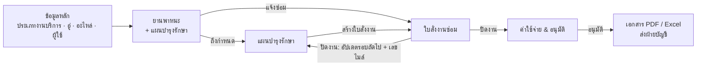
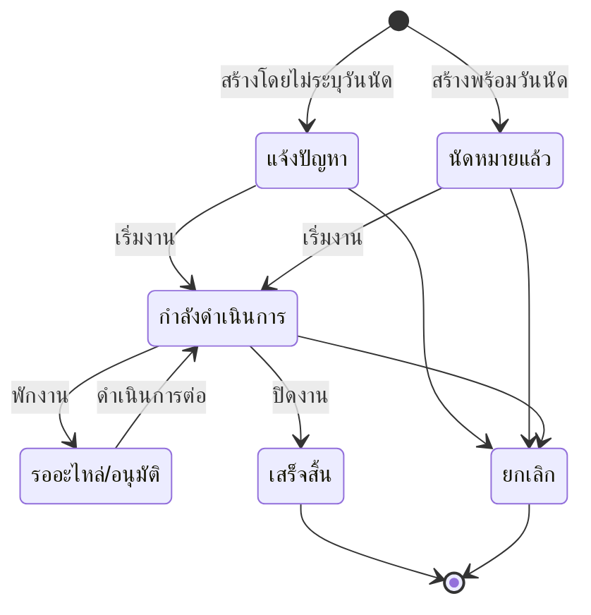
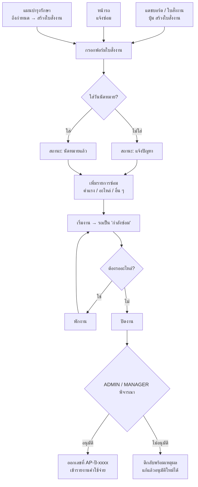

# FleetCare: Flow การทำงานของแต่ละเมนู

ระบบซ่อมบำรุงยานพาหนะ: วางแผนบำรุงรักษา ติดตามงานซ่อม และควบคุมค่าใช้จ่าย จนถึงออกใบอนุมัติให้ฝ่ายบัญชี

## ภาพรวมทั้งระบบ

ลำดับการตั้งระบบครั้งแรก: **ผู้ใช้งาน → ประเภทงานบริการ → อู่ / อะไหล่ → ยานพาหนะ → แผนบำรุงรักษา** จากนั้นใช้งานประจำวันผ่านแดชบอร์ดและใบสั่งงาน

## สิทธิ์การใช้งาน

| ผู้ใช้ | ทำอะไรได้ |
|---|---|
| ผู้ดูแลระบบ (ADMIN) / ผู้จัดการยานพาหนะ (MANAGER) | ทุกอย่าง รวมถึง**อนุมัติหรือไม่อนุมัติค่าใช้จ่าย**และจัดการผู้ใช้งาน |
| ช่างซ่อม (TECHNICIAN) / พนักงานขับรถ (DRIVER) | เพิ่มและแก้ไขข้อมูลงานซ่อมได้ แต่อนุมัติค่าใช้จ่ายและจัดการผู้ใช้ไม่ได้ |
| ผู้เยี่ยมชม (Guest) | ดูได้อย่างเดียวทุกหน้า **ยกเว้นหน้าผู้ใช้งาน** ปุ่มเพิ่มหรือแก้ไขจะถูกซ่อน |

**การเข้าสู่ระบบ**
- เข้าได้เฉพาะอีเมลที่อยู่ในหน้า "ผู้ใช้งาน" และยังเปิดใช้งานอยู่
- ผู้ใช้ใหม่ต้องให้ ADMIN หรือ MANAGER เพิ่มอีเมลก่อน แล้วไปที่ "เปิดใช้งานบัญชี" เพื่อตั้งรหัสผ่าน

---

## 1. แดชบอร์ด (`/`)

หน้าแรกหลัง login สรุปสิ่งที่ต้องทำวันนี้

1. ดูตัวเลขสรุป: ยานพาหนะทั้งหมด, กำลังซ่อม, ใบสั่งงานที่เปิดอยู่, ค่าซ่อมเดือนนี้
2. **ถึงกำหนดบำรุงรักษา**: แผนที่เลยกำหนดหรือใกล้ถึงกำหนด (เหลือไม่ถึง 1,000 กม. หรือไม่ถึง 14 วัน)
3. **เอกสารใกล้หมดอายุ**: ภาษี พ.ร.บ. ประกัน ที่จะหมดภายใน 30 วัน
4. **ใบสั่งงานล่าสุด**: กดเข้าไปดูต่อได้
5. ปุ่ม **สร้างใบสั่งงาน** ใช้แจ้งซ่อมได้ทันที

## 2. ยานพาหนะ (`/vehicles`)

**หน้ารายการ**
- กรองตามสถานะ (พร้อมใช้งาน / กำลังซ่อม / พักใช้งาน / ปลดระวาง) และค้นหาทะเบียน ยี่ห้อ รุ่น
- **เพิ่มรถ**:
  - ทะเบียนและจังหวัด (เลือกจาก 77 จังหวัด)
  - ยี่ห้อและรุ่น (เลือกจากรายการ หรือพิมพ์เองได้)
  - ประเภท เชื้อเพลิง ปี สี เลขไมล์ วันที่ซื้อ VIN คนขับประจำ

**หน้ารายละเอียดรถ** (`/vehicles/[id]`)

| ส่วน | ทำอะไร |
|---|---|
| เปลี่ยนสถานะ | พร้อมใช้งาน / พักใช้งาน / ปลดระวาง (ปลดระวางต้องยืนยันก่อน) |
| เลขไมล์ | บันทึกเลขไมล์ล่าสุด เก็บเป็นประวัติ |
| แผนบำรุงรักษา | เพิ่มแผนจากประเภทงานบริการ เช่น เปลี่ยนน้ำมันเครื่องทุก 10,000 กม. หรือ 6 เดือน ระบบคำนวณกำหนดครั้งถัดไปให้ และแต่ละแผนมีปุ่มสร้างใบสั่งงาน |
| เอกสารรถ | ภาษี พ.ร.บ. ประกัน พร้อมวันหมดอายุ (ใช้แจ้งเตือนบนแดชบอร์ด) |
| ประวัติงานซ่อม | ใบสั่งงานทั้งหมดของรถคันนี้ |
| แจ้งซ่อม / สร้างใบสั่งงาน | เปิดฟอร์มใบสั่งงานโดยเลือกรถคันนี้ไว้ให้แล้ว |

## 3. ใบสั่งงานซ่อม (`/work-orders`)

หัวใจของระบบ: ทุกงานซ่อมหรือบำรุงรักษาต้องมีใบสั่งงาน (รายละเอียดเต็มอยู่ที่หัวข้อ [Flow การสร้างใบงาน](#flow-การสร้างใบงาน-ละเอียด))

**สถานะของใบสั่งงาน**

- หน้ารายการกรองตามสถานะได้ และค้นหาด้วยรหัสงาน (WO-ปี-เลขที่) ชื่องาน หรือทะเบียน

## 4. แผนบำรุงรักษา (`/maintenance`)

1. แสดงแผนของรถทุกคัน เรียงตามความเร่งด่วน: **เลยกำหนด → ใกล้ถึงกำหนด → ปกติ**
2. นับกำหนดจาก**ระยะทางหรือเวลา แล้วแต่อย่างใดถึงก่อน**
3. กด **สร้างใบสั่งงาน** ที่แผนนั้น ระบบจะเลือกรถ ใส่หัวข้อเป็นชื่องานบริการ และตั้งประเภทเป็น "บำรุงรักษาตามระยะ" ไว้ให้
4. เมื่อใบสั่งงานนั้น**ปิดงาน** ระบบเริ่มนับรอบใหม่จากวันที่และเลขไมล์ที่ปิดงานให้อัตโนมัติ

## 5. ค่าใช้จ่าย & อนุมัติ (`/expenses`)

1. **รอการอนุมัติ**: ใบสั่งงานที่ปิดงานแล้วแต่ยังไม่อนุมัติ (และที่ถูกตีกลับ)
2. ADMIN หรือ MANAGER เข้าไปที่ใบสั่งงาน แล้วกด **อนุมัติค่าใช้จ่าย** (ใส่รหัสบัญชีและหมายเหตุได้) หรือ**ไม่อนุมัติ** (ต้องใส่เหตุผล)
3. เมื่ออนุมัติ ระบบออก**เลขที่ใบอนุมัติ** `AP-ปี-เลขที่` และงานนั้นเข้ารายการ "อนุมัติแล้ว"
4. เลือกช่วงวันที่ แล้วกด **PDF** (หน้าพิมพ์ A4 แล้วสั่ง Save as PDF) หรือ **Export Excel** เพื่อส่งฝ่ายบัญชี
5. ใบสั่งงานแต่ละใบพิมพ์**ใบอนุมัติค่าใช้จ่าย**แยก (PDF/Excel) ได้

## 6. ประเภทงานบริการ (`/service-types`)

- รายการงานมาตรฐาน เช่น เปลี่ยนน้ำมันเครื่อง ผ้าเบรก ยาง พร้อม**รอบมาตรฐาน** (กม. / เดือน)
- ใช้เป็นแม่แบบตอนสร้างแผนบำรุงรักษา และใช้ผูกกับรายการในใบสั่งงาน
- เพิ่มได้ และเปิดหรือปิดใช้งานได้

## 7. อู่ / ศูนย์บริการ (`/providers`)

- รายชื่ออู่ภายนอกหรือศูนย์บริการ (ผู้ติดต่อ โทรศัพท์ อีเมล เลขประจำตัวผู้เสียภาษี ที่อยู่)
- ใช้เลือกในใบสั่งงานว่าส่งซ่อมที่ไหน
- เพิ่มได้ และเปิดหรือปิดใช้งานได้

## 8. อะไหล่ & สต็อก (`/parts`)

- ทะเบียนอะไหล่: รหัส ชื่อ หน่วย ราคาต่อหน่วย จำนวนคงเหลือ จุดสั่งซื้อ
- **ปรับสต็อก** เมื่อรับของเข้าหรือตรวจนับ
- ใบสั่งงานใช้อะไหล่แล้ว**ตัดสต็อกอัตโนมัติ** และลบรายการแล้ว**คืนสต็อก**

## 9. ผู้ใช้งาน (`/users`)

ADMIN และ MANAGER เท่านั้น (Guest มองไม่เห็นเมนูนี้)

1. **เพิ่มผู้ใช้**: ชื่อ อีเมล บทบาท เท่ากับเพิ่มอีเมลเข้ารายชื่อที่ login ได้
2. ผู้ใช้ไปที่หน้า login → **เปิดใช้งานบัญชี** เพื่อตั้งรหัสผ่านเอง
3. **ปิดใช้งาน** ได้ แล้วผู้ใช้นั้นจะ login ไม่ได้ทันที (ปิดบัญชีตัวเองไม่ได้)

---

## Flow การสร้างใบงาน (ละเอียด)

### ขั้นที่ 1: เปิดใบสั่งงาน
เข้าได้ 3 ทาง:
- **แจ้งซ่อมทั่วไป**: ปุ่ม "สร้างใบสั่งงาน" ที่แดชบอร์ดหรือหน้าใบสั่งงาน
- **จากหน้ารถ**: ปุ่ม "แจ้งซ่อม / สร้างใบสั่งงาน" ระบบเลือกรถไว้ให้
- **จากแผนบำรุงรักษา**: ระบบเลือกรถ ใส่หัวข้อ ตั้งประเภทเป็นบำรุงรักษาตามระยะ และ**ผูกใบสั่งงานกับแผนนั้น**ไว้ให้

### ขั้นที่ 2: กรอกฟอร์ม
| ช่อง | หมายเหตุ |
|---|---|
| รถ * / หัวข้องาน * | บังคับกรอก |
| ประเภทงาน | บำรุงรักษาตามระยะ / ซ่อมแก้ไข / ตรวจสภาพ / อุบัติเหตุ |
| ความเร่งด่วน | ต่ำ / ปานกลาง / สูง / เร่งด่วน |
| วันนัดหมาย | ใส่ = "นัดหมายแล้ว", ไม่ใส่ = "แจ้งปัญหา" |
| เลขไมล์ขณะเข้ารับบริการ | ใช้อัปเดตเลขไมล์รถตอนปิดงาน |
| อู่ / ผู้รับผิดชอบ | ไม่บังคับ แก้ภายหลังได้ |
| อาการ / รายละเอียด | อธิบายปัญหา |

กดบันทึกแล้ว ระบบ:
- ออกรหัส **WO-ปี-เลขที่** เช่น WO-2026-0001
- บันทึกผู้แจ้งเป็นคนที่ login อยู่
- พาไปหน้ารายละเอียดใบงาน

### ขั้นที่ 3: ใส่รายการซ่อม
ในหน้าใบงาน ส่วน "รายการค่าใช้จ่าย" เพิ่มได้ทีละรายการ:
- **ค่าแรง**: รายละเอียด จำนวน ราคาต่อหน่วย
- **อะไหล่**: เลือกจากสต็อก ระบบดึงชื่อและราคาให้ และ**ตัดสต็อกทันที**
- **อื่น ๆ**: ค่าใช้จ่ายอื่น
- ผูกรายการกับ**งานบริการ** (เช่น เปลี่ยนน้ำมันเครื่อง) ได้ เพื่อให้ระบบอัปเดตแผนบำรุงรักษาของงานนั้นตอนปิดงาน
- ระบบรวมยอด ค่าแรง / อะไหล่ / อื่น ๆ / รวมทั้งสิ้น ให้อัตโนมัติ
- ลบรายการได้ (ต้องยืนยัน) ถ้าเป็นอะไหล่จะคืนเข้าสต็อก
- ระหว่างนี้แก้ไขอู่ ผู้รับผิดชอบ เลขที่ใบแจ้งหนี้ และหมายเหตุได้

### ขั้นที่ 4: ดำเนินงาน
- **เริ่มงาน**: สถานะเป็น "กำลังดำเนินการ" และ**รถเปลี่ยนเป็น "กำลังซ่อม"** อัตโนมัติ
- **พักงาน**: สถานะเป็น "รออะไหล่/อนุมัติ" แล้วกด "ดำเนินการต่อ" เมื่อพร้อม
- **ยกเลิก**: ต้องยืนยันก่อน ถ้ารถไม่มีงานอื่นค้างอยู่ จะกลับเป็น "พร้อมใช้งาน"

### ขั้นที่ 5: ปิดงาน (ต้องยืนยัน)
ระบบทำ 4 อย่างอัตโนมัติ:
1. **ล็อกใบงาน**: แก้ไขรายการไม่ได้อีก
2. **เลขไมล์**: ถ้าเลขไมล์ในใบงานมากกว่าของรถ จะอัปเดตเลขไมล์รถและเก็บประวัติ
3. **แผนบำรุงรักษา**: แผนที่ผูกกับใบงานนี้ และแผนของงานบริการในรายการ จะเริ่มนับรอบใหม่จากวันนี้และเลขไมล์นี้
4. **สถานะรถ**: กลับเป็น "พร้อมใช้งาน" ถ้าไม่มีงานอื่นกำลังซ่อมอยู่ และใบงานเข้าสถานะ **"รออนุมัติค่าใช้จ่าย"**

### ขั้นที่ 6: อนุมัติค่าใช้จ่าย (ADMIN / MANAGER)
- **อนุมัติ**:
  - ใบงานต้องปิดแล้วและยอดมากกว่า 0
  - ระบบออกเลข **AP-ปี-เลขที่** ใส่รหัสบัญชีและหมายเหตุได้
  - ใบงานเข้ารายงานค่าใช้จ่าย และพิมพ์ใบอนุมัติเป็น PDF/Excel ได้
- **ไม่อนุมัติ**: ต้องใส่เหตุผล งานจะกลับไปอยู่ในรายการรออนุมัติ และพิจารณาใหม่ได้
